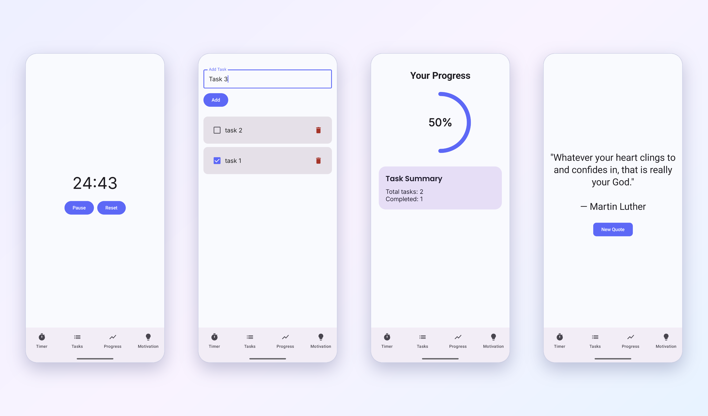

# StudyBuddy

An Android study productivity app that puts a focus timer, task manager, progress tracker, and motivation screen in one place. It began as a project for my Mobile Application Development course (Fall 2025) and is still in active development.

## Screenshots



## Features

- **Timer:** a 25-minute focus countdown with start, pause, and reset
- **Tasks:** add, complete, and delete tasks; tasks are saved on the device, so they are still there when you reopen the app
- **Progress:** an animated progress ring and a summary of total and completed tasks
- **Motivation:** a new inspirational quote on demand, fetched over the network
- Bottom navigation across all four screens

## Built with

- Kotlin
- Jetpack Compose and Material 3
- Navigation Compose
- ViewModels with Kotlin coroutines and StateFlow
- Gson for saving tasks as JSON on the device
- OkHttp for loading quotes

## Project structure

```
app/src/main/java/com/example/studybuddy/
├── data/         # TaskRepository (local JSON storage), QuotesRepository (network)
├── models/       # Task data class
├── nav/          # Screen routes
├── ui/screens/   # Timer, Tasks, Progress, and Motivation screens
├── ui/theme/     # Colors, typography, theme
└── viewmodels/   # State for tasks, quotes, progress, and timer
```

## Run it

1. Clone this repository.
2. Open the folder in Android Studio and let Gradle sync.
3. Run on an emulator or an Android device (Android 7.0 / API 24 or higher).

The Motivation screen needs an internet connection.

## Roadmap

- [ ] Turkish localization of the interface
- [ ] Move task storage from a JSON file to Room/SQLite
- [ ] Mobile security review of the app, with documented findings and fixes

## Credits

Quotes are provided by the [ZenQuotes API](https://zenquotes.io/).
